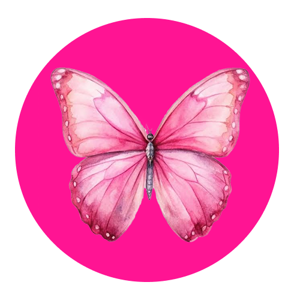

  
  <h1>Borboleta Pink Acessórios</h1>
  
<i>Projeto de Identidade Visual e Design System criado por Amanda Amaral</i>

## 📝 Descrição do Projeto e Conceito Visual

Logotipo desenvolvido com foco em minimalismo, sofisticação e alta legibilidade para o mercado de e-commerce de acessórios. 

### 🦋 Construção Técnica no Figma
* **Ícone Principal:** Borboleta estilizada em aquarela, estruturada de forma simétrica para transmitir leveza e transformação.
* **Paleta de Cores:** Base sólida em Rosa Choque (`#FF1493`) com contrastes em tons pastel, garantindo um alto impacto visual e ótima legibilidade.
* **Grid e Proporções:** Ativo desenhado em um frame quadrado de 500x500 px, perfeitamente centralizado e projetado para se adaptar tanto a formatos quadrados quanto a cortes circulares (avatares).

### 🛠️ Otimização para Front-End e UI/UX
* **Assets Limpos:** Fundo quadriculado e ruídos removidos para garantir transparência total e evitar problemas de sobreposição via CSS.
* **Responsividade:** Preparado para manter a nitidez absoluta em telas de alta densidade (Retina/4K), funcionando desde tamanhos reduzidos (Favicon 32x32 px) até resoluções máximas.
* **Acessibilidade:** Cores validadas para manter o contraste perfeito e excelente visibilidade tanto em Light Mode quanto em Dark Mode.
